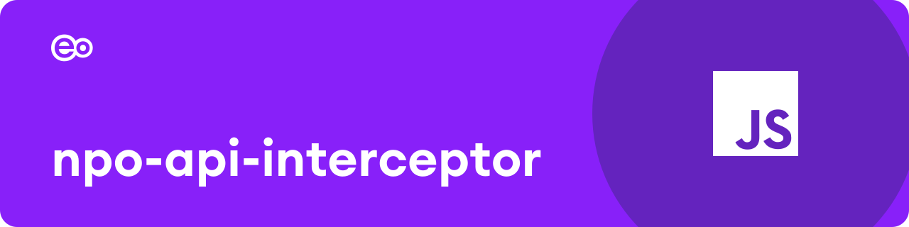

<p align="center">Signs your requests to the NPO API, from the browser or Node.js.</p>

Request Interceptor for using the NPO API with [Axios](https://www.npmjs.com/package/axios), [AngularJS's $http service](https://docs.angularjs.org/api/ng/service/$http) or even [jQuery.ajax](http://api.jquery.com/jQuery.ajax/). Calculates and adds the necessary authorization headers to the request. The NPO API Interceptor can be used both in the browser and in Node.js.

## What it does

- **Signs NPO API requests.** With your API key and secret it adds the `Authorization` and `X-NPO-Date` headers the NPO API expects.
- **Leaves other requests alone.** Only requests to the production and test NPO API are signed; everything else passes through unchanged.
- **Works with your HTTP client.** Plug it into Axios or AngularJS as a request interceptor, or call it yourself before `jQuery.ajax`.
- **Runs on the server too.** In Node.js you pass the origin that the NPO API has whitelisted for you.

## Installation

Install via npm:

```bash
npm install --save npo-api-interceptor
```

or Yarn:

```bash
yarn add npo-api-interceptor
```

If you don't use a module bundler like Webpack or Browserify in your project, a browser build is available at `lib/npoapiinterceptor.js`. This build makes the NPO API Interceptor available on the global `npoApiInterceptor` variable.

As this depends on [jsSHA](https://github.com/Caligatio/jsSHA/), you need to include that dependency yourself.

## Usage with a module bundler

After installation (see above) you can `import` the interceptor and use it. The interceptor takes at least an API key and secret and returns a function (the actual interceptor) that Axios or AngularJS will call when performing requests. Example:

```js
import axios from 'axios'
import npoApiInterceptor from 'npo-api-interceptor'

axios.interceptors.request.use(npoApiInterceptor({
  key: '<your-key>',
  secret: '<your-secret>'
}))
```

## Usage without a module bundler

After installation (see above) the interceptor is available on the global `npoApiInterceptor` variable. The interceptor takes at least an API key and secret and returns a function (the actual interceptor) that Axios or AngularJS will call when performing requests. Example:

```js
axios.interceptors.request.use(npoApiInterceptor({
  key: '<your-key>',
  secret: '<your-secret>'
}))
```

## Usage with Angular

The NPO API Interceptor can be provided as an [interceptor](https://docs.angularjs.org/api/ng/service/$http#interceptors) to the `$http` service. Example using an anonymous factory:

```js
$httpProvider.interceptors.push(function() {
  return {
    request: npoApiInterceptor({
      key: '<your-key>',
      secret: '<your-secret>'
    })
  };
});
```

## Usage with jQuery.ajax

Even though jQuery.ajax() doesn't have the concept op request interceptors, the NPO API Interceptor can be used to add the necessary headers to the request. But you need to be prepared to jump through a couple of hoops. Example of a Find media (`POST /media`) request:

```js
var interceptor = window.npoApiInterceptor({
  key: '<your-key>',
  secret: '<your-secret>'
});

// An object of the URL parameters you will use:
var params = {
  profile: 'eo',
  max: '100'
};

var url = 'https://rs.poms.omroep.nl/v1/api/media/';

var config = {
  type: 'POST',
  // Add params as query string to the URL
  url: url + '?' + jQuery.params(params),
  // Add params property for NPO API Interceptor, jQuery.ajax doesn't use it
  params: params,
  data: JSON.stringify({
    searches: {
      types: 'SERIES'
    }
  }),
  dataType: 'json'
};

interceptor(config).then(function(config) {
  // Wrap jQuery.ajax in a Promise to return a real Promise instead of a Promise-like jqXHR object
  return new Promise(function(resolve, reject) {
    jQuery.ajax(config).done(resolve).fail(reject);
  });
});
```

## Usage in Node.js

When using the NPO API Interceptor server-side, the required `Origin` header isn't present on API requests. Therefore, you should specify an origin in the interceptor config:

```js
axios.interceptors.request.use(npoApiInterceptor({
  key: '<your-key>',
  secret: '<your-secret>',
  origin: 'https://www.example.com'
}))
```

Note that this origin should be whitelisted to access the NPO API.

## Browser support

The NPO API Interceptor depends on one ES2015 feature: Promises. A polyfills is not included, you need to polyfill it in your project, depending on your browser support level.

## Contributing

Working on this repo? [AGENTS.md](./AGENTS.md) has the setup, conventions and checks.
